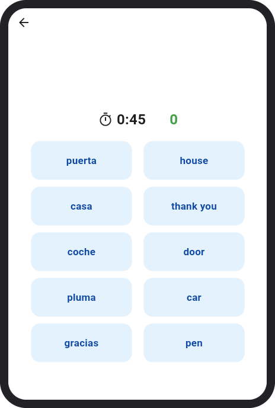

# Vocabulary Match

A small vocabulary practice game, inspired by the word-matching bubbles in Duolingo.

The screen shows two columns of bubbles: foreign words on one side and their English meanings on the other. Tap a word, then tap its meaning. A correct pair turns green and is replaced by a new one; a wrong pair flashes red. Match as many pairs as you can before the timer runs out (30 seconds or 1 minute).

<p align="center">
  
</p>

## Features

- **Your own word list.** Add, edit and search words in the app, or upload a CSV file (column A the foreign word, column B the English meaning). A word can have more than one meaning. The list can also be downloaded as a CSV.
- **Spaced practice.** The app remembers every guess and picks the next word to show based on how likely you are to have forgotten it. Words you get wrong come up more often. The method can be changed on the Settings screen.
- **Runs anywhere Flet does.** Android, iOS, desktop (Windows, macOS, Linux) and the web, built from one Python codebase with [Flet](https://flet.dev).

The app starts with a short list of Spanish words so it can be tried straight away.

## Run the app

Requires [uv](https://docs.astral.sh/uv/).

Run as a desktop app:

```bash
uv run flet run
```

Run as a web app:

```bash
uv run flet run --web
```

For more details on running the app, refer to the [Flet Getting Started Guide](https://flet.dev/docs/).

## Run the tests

```bash
uv run pytest
```

## Build the app

Each platform has its own build command. See the linked Flet guide for signing and packaging details.

| Platform | Command | Guide |
| --- | --- | --- |
| Android | `uv run flet build apk -v` | [Android Packaging Guide](https://flet.dev/docs/publish/android/) |
| iOS | `uv run flet build ipa -v` | [iOS Packaging Guide](https://flet.dev/docs/publish/ios/) |
| macOS | `uv run flet build macos -v` | [macOS Packaging Guide](https://flet.dev/docs/publish/macos/) |
| Linux | `uv run flet build linux -v` | [Linux Packaging Guide](https://flet.dev/docs/publish/linux/) |
| Windows | `uv run flet build windows -v` | [Windows Packaging Guide](https://flet.dev/docs/publish/windows/) |
| Web | `uv run flet build web -v` | [Web Packaging Guide](https://flet.dev/docs/publish/web/) |
